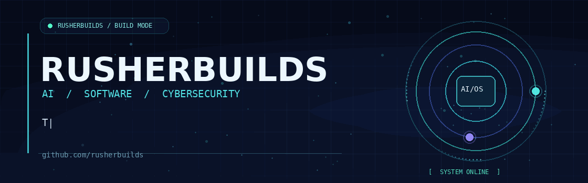

<!--
  PREMIUM GITHUB PROFILE
  Username: rusherbuilds
  Edit the headline, focus areas, and links to reflect your real work.
  GitHub README supports Markdown/limited HTML, not arbitrary JavaScript or CSS.
-->

### Software Engineering · AI Exploration · Building & Learning

---

## `> whoami`

I'm interested in **AI systems**, **software engineering**, **cybersecurity**, and **automation**. I like turning complex concepts into usable tools, with an emphasis on testing, maintainability, and clarity.

The silver character above is part of this profile's visual identity. It is artwork, not a claim about my appearance or an automatically changed GitHub account avatar.

- **Currently exploring:** agent-based software, automation, and practical security engineering
- **Approach:** understand the problem → prototype → test → improve
- **Projects:** browse the public repositories below or visit my portfolio

## `> tech_stack_and_projects`

<!-- EDIT THIS TABLE TO ADD YOUR OWN PROJECTS AND TOOLS -->
<h2 align="center">TECH STACK · PROJECTS · TOOLS</h2>
<table align="center">
  <thead><tr><th align="left" width="240">Property</th><th align="left">Data</th></tr></thead>
  <tbody>
    <tr><td><strong>Languages / IDE</strong></td><td>
      
      
      
      
      
      
      
    </td></tr>
    <tr><td><strong>Domain Knowledge</strong></td><td>
      
      
      
      
      
    </td></tr>
    <tr><td><strong>Development / CI-CD</strong></td><td>
      
      
      
      
      
      
    </td></tr>
    <tr><td><strong>Databases</strong></td><td>
      
      
    </td></tr>
    <tr><td><strong>ML / Deep Learning</strong></td><td>
      
      
    </td></tr>
    <!-- PROJECTS_ROW_START -->
    <tr><td><strong>My Projects</strong></td><td>
      
      <!-- Replace this placeholder with another real repository. -->
      
      
    </td></tr>
    <!-- PROJECTS_ROW_END -->
    <!-- TOOLS_ROW_START -->
    <tr><td><strong>My Tools & Utilities</strong></td><td>
      <!-- Replace this placeholder with your own tool's name and GitHub URL. -->
      
    </td></tr>
    <!-- TOOLS_ROW_END -->
  </tbody>
</table>

Keep badges aligned with technologies you genuinely use. Edit rows directly in this README.

## `> activity`

  
  

## `> contribution_arcade`

<!-- This starts working after the GitHub Action creates the output branch. -->

<b>Open the alternative Snake contribution animation</b>

 

## `> featured_repositories`

The projects below are not fictional placeholders: **use GitHub's pinned repositories** on the profile page to showcase your real work. Pin your best 4–6 repositories under **Customize your pins**.

- [Browse my public repositories](https://github.com/rusherbuilds?tab=repositories)
- [Portfolio with live repository cards](https://rusherbuilds.github.io/rusherbuilds/)

---

  BUILD WITH INTENT · TEST WHAT MATTERS · SHIP WHAT WORKS
   
  Profile: <a href="https://github.com/rusherbuilds">@rusherbuilds</a>

